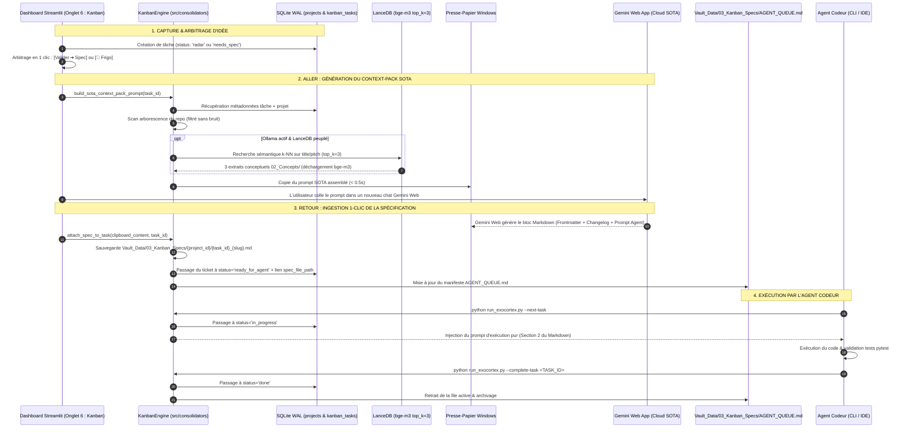

# CHANGELOG & SPÉCIFICATIONS TECHNIQUES — VERSION v0.2.0 (MODULE 7 : KANBAN EXÉCUTIF & SOTA SPEC BRIDGE)

**Projet :** Exocortex & Télémétrie Cognitive  
**Date :** 22 Octobre 2026  
**Version cible :** `v0.2.0-core`  
**Statut :** Spécification technique & Plan d'implémentation validé  
**Environnement Matériel :** Windows 11 Pro 64-bit, GPU NVIDIA RTX 4070 Ti Super (16 Go VRAM), CPU Intel Core i7-14700KF, 64 Go RAM DDR5.

---

## 1. CONTEXTE & VISION DU MODULE 7

Jusqu'à la version `v0.1.4`, l'Exocortex excellait dans son rôle d'observateur cognitif passif et de consolidateur épistémique :
- Capture de télémétrie Windows 11 en temps réel (0 Mo VRAM, < 2 % CPU).
- Sommeil paradoxal bi-modèle (Fast Vision 12B $\rightarrow$ Synthèse 26B $\rightarrow$ Vectorisation LanceDB BGE-M3).
- Ingestion historique Takeout (480 sessions qualifiées, 6 649 messages, 73 153 empreintes).
- Tableau de bord analytique complet ("Bandeur de Stats").

**Carence majeure identifiée :**
L'Exocortex manquait d'un bras armé **exécutif et décisionnel**. Le passage d'une idée ou d'un besoin technique à une tâche actionnable nécessitait des allers-retours manuels fastidieux entre la réflexion, la rédaction de spécifications techniques dans Gemini Web App (Cloud SOTA), et l'exécution par un agent codeur local.

**L'Objectif de la v0.2.0 :**
Implémenter le **Module 7 : Kanban Exécutif Multi-Projets & Pont Cloud SOTA**, une boucle fermée d'ingénierie logicielle fonctionnant à 0 Mo VRAM au repos, pilotée par le principe **« 1 Projet = 1 Vue »** et un mécanisme d'échange **« Aller-Retour en 1 Clic via Presse-Papier »** avec Gemini Web App.

---

## 2. ARCHITECTURE DU FLUX D'EXÉCUTION (LE PONT SOTA)

---

## 3. MODÈLE DE DONNÉES RELATIONNEL & WORKFLOW

### A. Tables SQLite Dédiées (`telemetry.db`)

Au lieu d'une configuration statique rigide, la persistance est totalement dynamique :

1. **Table `projects`** :
   - `project_id TEXT PRIMARY KEY` : Slug unique en minuscules (ex: `exocortex`, `homelab-media`, `astro-portfolio`).
   - `name TEXT NOT NULL` : Nom complet d'affichage (ex: `Exocortex & Télémétrie Cognitive`).
   - `prefix TEXT NOT NULL` : Préfixe court de 2 à 5 caractères pour les tickets (ex: `EXO`, `HLAB`, `ASTRO`).
   - `repo_path TEXT` : Chemin local absolu du dépôt git pour l'extraction automatique de l'arborescence.
   - `description TEXT NOT NULL` : Pitch et périmètre architectural du projet.
   - `created_at DATETIME NOT NULL` : Date de création.

   *Amorçage initial :* Le projet `exocortex` est injecté automatiquement au premier démarrage avec `repo_path = _PROJECT_ROOT`.

2. **Table `kanban_tasks`** :
   - `task_id TEXT PRIMARY KEY` : Identifiant déterministe incrémental (ex: `EXO-001`, `EXO-002`).
   - `project_id TEXT NOT NULL` : Clé étrangère vers `projects(project_id)`.
   - `component_tag TEXT NOT NULL DEFAULT 'general'` : Tag libre de sous-module (ex: `module-6-dashboard`, `module-3-consolidator`, `infra`, `ui`).
   - `title TEXT NOT NULL` : Intitulé clair de la tâche.
   - `summary_pitch TEXT NOT NULL DEFAULT ''` : Contexte, besoins et contraintes exprimés par l'utilisateur.
   - `status TEXT NOT NULL DEFAULT 'radar'` : L'un des 6 états du workflow.
   - `priority INTEGER NOT NULL DEFAULT 2` : 1 (Urgent/Bloquant), 2 (Normal), 3 (Secondaire), 4 (Optionnel).
   - `complexity TEXT NOT NULL DEFAULT 'M'` : `S`, `M`, `L`, `XL`.
   - `spec_file_path TEXT` : Chemin vers le fichier Markdown généré (`Vault_Data/03_Kanban_Specs/{project_id}/{task_id}_{slug}.md`).
   - `created_at DATETIME NOT NULL`
   - `updated_at DATETIME NOT NULL`
   - Index composite : `CREATE INDEX idx_kanban_proj_status ON kanban_tasks(project_id, status);`.

### B. Les 6 États du Workflow

| Statut | Nom d'affichage & Rôle | Transition Suivante |
|---|---|---|
| `radar` | 📡 **Radar / Idée** : Idée brute capturée à la volée. | `[Valider ➔ Spec]` $\rightarrow$ `needs_spec` ou `[🧊 Frigo]` $\rightarrow$ `icebox`. |
| `needs_spec` | 📝 **Nécessite Spec + Prompt** : Idée validée. Prête pour le pont SOTA. | `[📋 Copier Context-Pack]` $\rightarrow$ Gemini Web $\rightarrow$ `[📥 Lier Spec]` $\rightarrow$ `ready_for_agent`. |
| `ready_for_agent` | 🎯 **Prêt pour Agent** : Fichier spec `.md` attaché et validé. | `[🤖 Copier Prompt]` ou CLI `--next-task` $\rightarrow$ `in_progress`. |
| `in_progress` | ⚙️ **En Cours** : Tâche en cours de développement par l'agent. | `[✅ Marquer Terminé]` ou CLI `--complete-task` $\rightarrow$ `done`. |
| `done` | ✅ **Terminé** : Déployé, testé et archivé. | Conservé pour audit et traçabilité (specs historiques v0.0 à v0.1.4 incluses). |
| `icebox` | 🧊 **Frigo / Écarté** : Idée explorée mais non retenue. | Masquée par défaut ; restaurable vers `radar` en 1 clic. |

---

## 4. DÉTAIL DES CHANTIERS TECHNIQUES (LOTS D'IMPLÉMENTATION)

### Lot 1 : Configuration & Chemins (`src/config.py`)
- Ajout de la propriété `KANBAN_SPECS_DIR` retournant `Vault_Data/03_Kanban_Specs`.
- Ajout de la propriété `AGENT_QUEUE_PATH` retournant `Vault_Data/03_Kanban_Specs/AGENT_QUEUE.md`.
- Intégration de `KANBAN_SPECS_DIR` dans `ensure_directories()`.

### Lot 2 : Modèles Pydantic & Couche SQL (`src/database/db_manager.py`)
- Modèles de données Pydantic v2 : `ProjectRecord` et `KanbanTaskRecord`.
- Migration DDL : Création des tables `projects` et `kanban_tasks` avec index.
- Amorçage idempotent du projet `exocortex` (`INSERT OR IGNORE`).
- Méthodes CRUD thread-safe :
  - `get_projects() -> List[Dict[str, Any]]`
  - `get_project_by_id(project_id: str) -> Optional[Dict[str, Any]]`
  - `upsert_project(project: ProjectRecord) -> None`
  - `generate_next_task_id(project_id: str) -> str` : Analyse les IDs existants pour ce préfixe et incrémente (`EXO-001`, `EXO-002`...).
  - `upsert_kanban_task(task: KanbanTaskRecord) -> str`
  - `update_kanban_task_status(task_id: str, new_status: str, spec_file_path: Optional[str] = None) -> bool`
  - `update_kanban_task_details(...) -> bool`
  - `delete_kanban_task(task_id: str) -> bool`
  - `get_kanban_tasks(project_id: Optional[str] = None, statuses: Optional[List[str]] = None) -> List[Dict[str, Any]]`
  - `get_kanban_task_by_id(task_id: str) -> Optional[Dict[str, Any]]`
- Intégration dans `get_database_stats()`.

### Lot 3 : Moteur Métier Kanban & Pont SOTA (`src/consolidators/kanban_engine.py`)
Création du composant central `KanbanEngine` :
1. `sync_existing_tech_specs()` : Scanne récursivement le dossier `tech specs/` et indexe tous les changelogs/specs existants (`0.0`, `0.1`, `0.1.1`, `0.1.2`, `0.1.3`, `0.1.4`) comme tâches terminées (`status="done"`, `component_tag="core-architecture"`) rattachées au projet `exocortex`.
2. `build_sota_context_pack_prompt(task_id: str) -> str` :
   - Extrait l'arborescence du dépôt en filtrant strictement les dossiers parasites (`.git`, `node_modules`, `__pycache__`, `Vault_Data`, `models`, `takeout_raw`, `.pytest_cache`).
   - Interroge LanceDB (`vector_store.search`) si Ollama est actif pour injecter les 3 concepts les plus proches du pitch, puis purge la VRAM.
   - Formate le prompt d'architecture SOTA avec contrat strict Markdown.
3. `attach_spec_to_task(raw_markdown: str, target_task_id: Optional[str] = None) -> Dict[str, Any]` :
   - Extrait le `task_id` du frontmatter YAML ou du titre Markdown.
   - Enregistre le fichier sous `Vault_Data/03_Kanban_Specs/{project_id}/{task_id}_{slug}.md`.
   - Met à jour le ticket vers `ready_for_agent` et lie le fichier.
   - Régénère le manifeste `AGENT_QUEUE.md`.
4. `extract_coder_prompt_from_spec(task_id: str) -> str` : Découpe chirurgicalement le Markdown pour n'extraire que la section `## 2. PROMPT D'EXÉCUTION POUR L'AGENT CODEUR`.
5. `compile_agent_queue_manifest() -> Path` : Rédige le document `Vault_Data/03_Kanban_Specs/AGENT_QUEUE.md` listant les tâches prêtes et en cours par ordre de priorité.

### Lot 4 : Interface Dashboard Streamlit (`src/dashboard/app.py`)
Ajout de l'**Onglet 6 — 📋 Kanban & Studio SOTA** :
- **En-tête & Sélecteur de Projet** : Menu déroulant « 1 Projet = 1 Vue » + popover d'ajout immédiat d'un nouveau projet.
- **Filtres** : Par `component_tag` et recherche textuelle.
- **Barre d'Actions Rapides** :
  - `➕ Nouvelle Idée / Tâche` : Modal/expander de création directe.
  - `📥 Ingérer Spec depuis Gemini Web` : Collage direct du presse-papier Windows (`pyperclip.paste()`) ou champ texte de secours.
- **Tableau Kanban en 4 colonnes visuelles** :
  - **Colonne 1 (📡 Radar / Idées)** : Cartes avec boutons `[✅ Valider ➔ Spec]` et `[🧊 Frigo]`.
  - **Colonne 2 (📝 Nécessite Spec + Prompt)** : Cartes avec bouton `[📋 Copier Context-Pack (Gemini Web)]` (toast confirmation) et bouton retour 1-clic `[📥 Lier Spec du Presse-Papier]`.
  - **Colonne 3 (🎯 Prêt & ⚙️ En Cours)** : Badges distinctifs, bouton `[🤖 Copier Prompt Agent Codeur]` (passe en `in_progress`), expander de lecture de spec et `[✅ Marquer Terminé]`.
  - **Colonne 4 (✅ Terminé)** : Historique compact avec consultation des specs Markdown.
  - Case à cocher en bas de page pour explorer et réactiver les idées mises au `🧊 Frigo`.

### Lot 5 : Commandes CLI pour l'Agent Codeur (`run_exocortex.py`)
- `python run_exocortex.py --kanban-status [--project PROJECT_ID]` : Affiche l'état des tickets et actualise `AGENT_QUEUE.md`.
- `python run_exocortex.py --next-task [--project PROJECT_ID]` : Dépile la tâche la plus prioritaire en attente, la passe en `in_progress`, actualise `AGENT_QUEUE.md` et affiche le prompt de l'agent codeur sur la sortie standard.
- `python run_exocortex.py --complete-task TASK_ID` : Valide la fin du développement, passe la tâche en `done` et met à jour `AGENT_QUEUE.md`.

### Lot 6 : Suite de Tests Automatisée (`tests/test_v020_kanban_verification.py`)
Vérification automatisée de :
- Création dynamique de projets et génération d'IDs incrémentaux (`EXO-001`, `EXO-002`).
- Indexation sans doublon des documents de `tech specs/` en tâches `done`.
- Cycle de vie complet : `radar` $\rightarrow$ `needs_spec` $\rightarrow$ génération Context-Pack $\rightarrow$ attachement de spec $\rightarrow$ `ready_for_agent` $\rightarrow$ `in_progress` $\rightarrow$ `done`.
- Mise à jour du manifeste `AGENT_QUEUE.md`.
- Exécution de `pytest tests/` garantissant 100 % de réussite sur les suites `v012`, `v013`, `v014` et `v020`.

---
