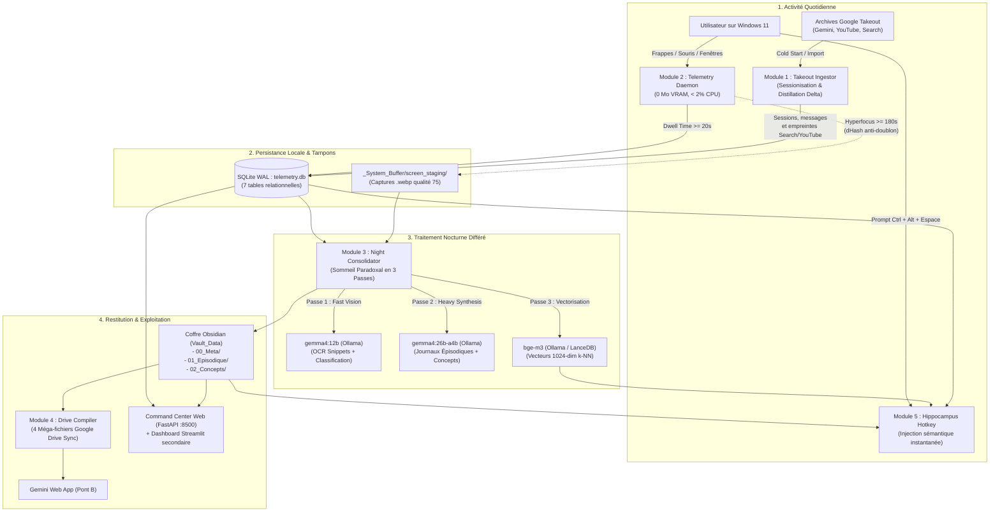
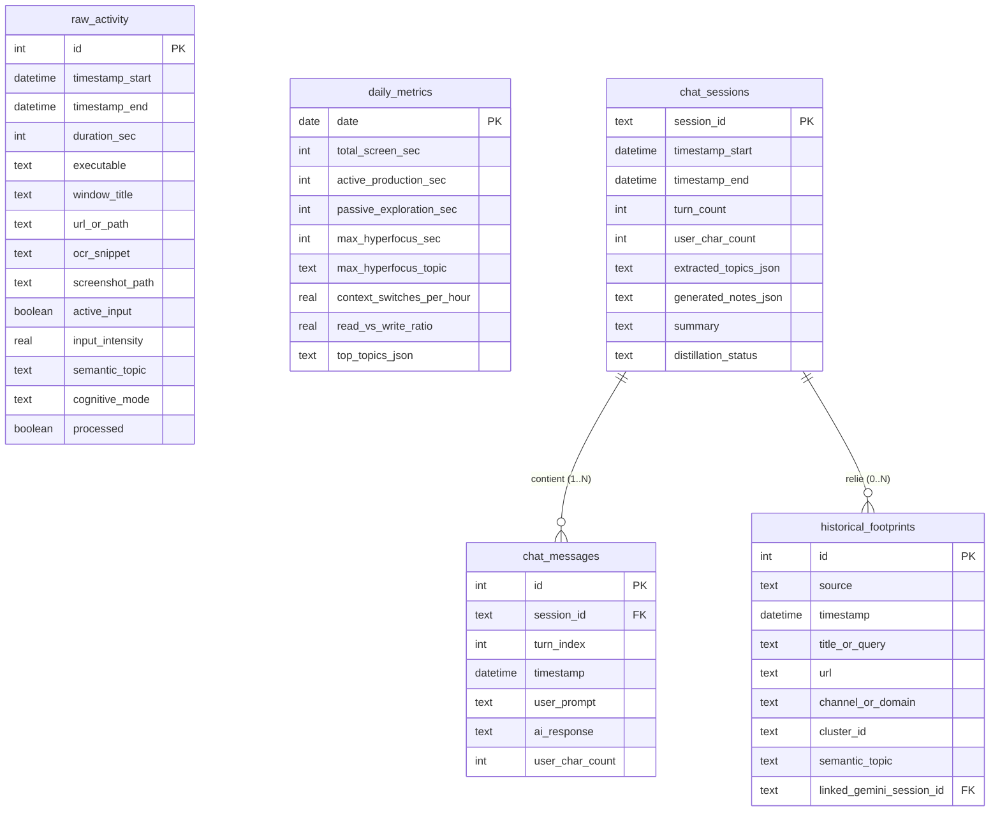
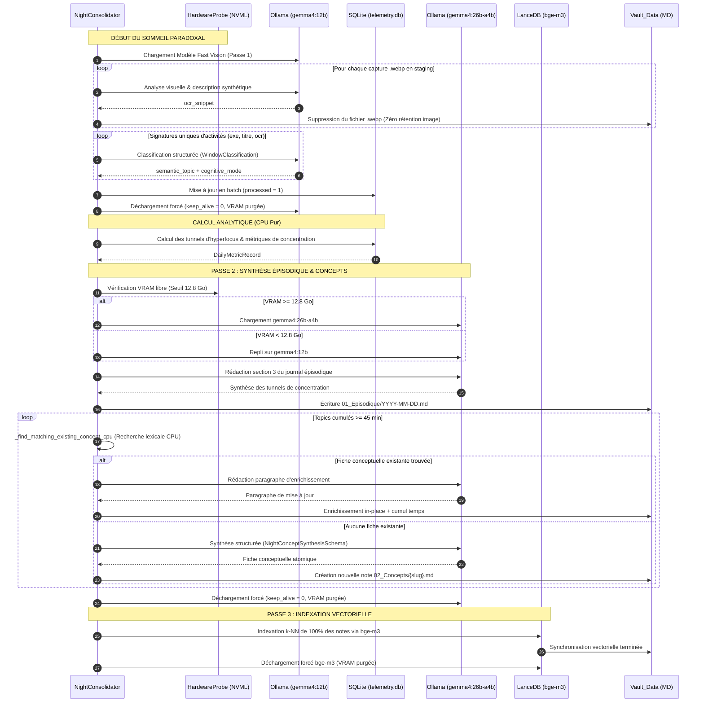

# 🧠 DOCUMENTATION TECHNIQUE & FONCTIONNELLE EXHAUSTIVE — EXOCORTEX & TÉLÉMÉTRIE COGNITIVE

**Système :** Exocortex & Télémétrie Cognitive  
**Version actuelle :** v0.5.7 (mise à jour suite à l'audit de conformité du 24 octobre 2026)  
**Date de révision :** 24 Octobre 2026  
**Environnement cible :** Windows 11 Pro 64-bit, GPU NVIDIA GeForce RTX 4070 Ti Super (16 Go VRAM), CPU Intel Core i7-14700KF, 64 Go RAM DDR5.

---

## TABLE DES MATIÈRES

1. [Vue d'Ensemble & Philosophie Architecturale](#1-vue-densemble--philosophie-architecturale)
2. [Invariants Matériels & Gestion Stricte de la VRAM (RTX 4070 Ti Super)](#2-invariants-matériels--gestion-stricte-de-la-vram)
3. [Architecture des Données & Persistance Locale](#3-architecture-des-données--persistance-locale)
4. [Module 1 : Ingestor Google Takeout & Cold Start Hybride](#4-module-1--ingestor-google-takeout--cold-start-hybride)
5. [Module 2 : Démon de Télémétrie Cognitive Temps Réel (0-VRAM)](#5-module-2--démon-de-télémétrie-cognitive-temps-réel)
6. [Module 3 : Consolidateur Nocturne & Sommeil Paradoxal (3 Passes)](#6-module-3--consolidateur-nocturne--sommeil-paradoxal)
7. [Module 4 : Compilateur Google Drive (Pont B - Gemini Web App)](#7-module-4--compilateur-google-drive)
8. [Module 5 : Injecteur Pré-Prompt Hippocampe Local (Pont A - Ctrl + Alt + Espace)](#8-module-5--injecteur-pré-prompt-hippocampe-local)
9. [Module 6 : Dashboard Streamlit "Bandeur de Stats"](#9-module-6--dashboard-streamlit-bandeur-de-stats)
10. [Moteur LLM Hybride, Modelfiles & Auto-Guérison JSON](#10-moteur-llm-hybride-modelfiles--auto-guérison-json)
11. [Taxonomie Sémantique Fermée & Règles Anti-Wikipédia](#11-taxonomie-sémantique-fermée--règles-anti-wikipédia)
12. [Scripts de Pilotage & Déploiement Opérationnel](#12-scripts-de-pilotage--déploiement-opérationnel)
13. [Modules ajoutés de v0.2 à v0.5.7](#13-modules-ajoutés-de-v02-à-v057)

---

## 1. VUE D'ENSEMBLE & PHILOSOPHIE ARCHITECTURALE

L'**Exocortex & Télémétrie Cognitive** est une architecture locale d'hippocampe artificiel et de quantification cognitive temps réel pour Windows 11. Son objectif est de capturer l'ensemble des traces d'activité intellectuelle de l'utilisateur sans friction ni saisie manuelle, de modéliser son attention et ses centres d'intérêt, et de réinjecter ce contexte de façon bi-directionnelle dans ses interactions avec les Grands Modèles de Langage (notamment Gemini).



### Principes Directeurs
1. **Zéro perturbation en temps réel :** Le démon de capture d'écran et d'activité n'effectue aucun calcul LLM lourd pendant les heures de travail. Son empreinte mémoire est nulle sur le GPU (0 Mo VRAM) et minime sur le processeur (< 2 % CPU).
2. **Exclusion mutuelle stricte VRAM :** Les modèles d'inférence (Vision 12B, Synthèse 26B, Embedding BGE-M3) ne sont jamais chargés simultanément sur la RTX 4070 Ti Super (16 Go VRAM).
3. **Souveraineté des données :** L'intégralité du traitement s'exécute sur le matériel local. Ne sortent de la machine que les 4 méga-documents de `Google_Drive_Sync/` si ce dossier est synchronisé (catégories sensibles exclues), et les sessions envoyées à Gemini en mode `cloud_api`.
4. **Anti-Wikipédia absolu :** Les fiches de connaissances capitalisent les décisions, architectures et commandes réelles testées par l'utilisateur, excluant toute paraphrase encyclopédique générique.

---

## 2. INVARIANTS MATÉRIELS & GESTION STRICTE DE LA VRAM

Le système est dimensionné pour tirer parti d'une carte graphique **NVIDIA GeForce RTX 4070 Ti Super (16 Go VRAM)** sous Windows 11 Pro.

### Contraintes Matérielles sous Windows 11
- **Réservation de l'OS (WDDM / DWM) :** Sous Windows 11, le système d'exploitation et le gestionnaire de fenêtres (Desktop Window Manager) préemptent en permanence entre **1,8 Go et 2,4 Go de VRAM**, laissant environ **13,6 Go à 14,2 Go** réellement exploitables.
- **Seuils d'arbitrage de la VRAM (`src/config.py`) :**
  - `VRAM_REASONING_MIN_FREE_GB = 12.8` (ancien nom `FULL_DUAL_MODEL_VRAM_GB`) : Seuil en deçà duquel le système refuse de charger le modèle lourd 26B et bascule automatiquement sur le modèle 12B.
  - `VRAM_STRICT_ABORT_FREE_GB = 8.0` (ancien nom `MIN_FREE_VRAM_GB`) : Seuil critique. Sous 8 Go libres, aucune inférence n'est lancée ; la consolidation nocturne bascule en mode CPU (métriques, journaux et Drive produits, synthèses LLM reportées).

### Mécanismes de Gestion VRAM (`src/llm/ollama_client.py`)
1. **Sonde matérielle dynamique (`HardwareProbe`) :**
   - Interroge prioritairement les compteurs bas niveau NVML via `pynvml`.
   - Repli transparent sur `nvidia-smi --query-gpu=memory.free,memory.total` en cas d'indisponibilité de NVML.
   - Si aucune sonde ne répond, la VRAM est supposée nulle (`VRAM_ASSUME_FREE_GB = 0`) : abstention plutôt que chargement à l'aveugle.
2. **Purge active & déchargement forcé (`force_clear_vram`) :**
   - Interroge l'API `http://localhost:11434/api/ps` d'Ollama pour lister les modèles résidant en VRAM.
   - Envoie une requête de déchargement explicite avec `keep_alive = 0` pour chaque modèle **de l'Exocortex** (12B, 26B, bge-m3) ; les modèles d'autres outils utilisant le même serveur ne sont pas touchés.
   - Aucune mémoire n'est gérée côté Python : la VRAM appartient au processus Ollama.
3. **Politique d'exclusion mutuelle :**
   - Lors de la transition entre la Passe 1 (Vision 12B), la Passe 2 (Synthèse 26B) et la Passe 3 (BGE-M3), la mémoire GPU est systématiquement réinitialisée à zéro.
   - **Entre processus**, un verrou fichier (`_System_Buffer/vram.lock`) garantit qu'un seul processus Exocortex (nuit, ingestion, API, injecteur, MCP) utilise le GPU à la fois. Les traitements par lots le détiennent pour toute leur durée ; les appels interactifs attendent au plus quelques secondes.
4. **Configuration du serveur Ollama :** `OLLAMA_FLASH_ATTENTION`, `OLLAMA_KV_CACHE_TYPE=q8_0`, `OLLAMA_MAX_LOADED_MODELS=1` et `OLLAMA_NUM_PARALLEL=1` doivent être définis au niveau utilisateur (`setx`) puis Ollama redémarré ; `--init-models` vérifie l'environnement réel du processus serveur.

---

## 3. ARCHITECTURE DES DONNÉES & PERSISTANCE LOCALE

### A. Base Relationnelle SQLite WAL (`Vault_Data/_System_Buffer/telemetry.db`)
La persistance est assurée par `DBManager` (`src/database/db_manager.py`), configuré avec les pragmas haute performance :
- `PRAGMA journal_mode=WAL;` (Write-Ahead Logging autorisant des lectures concurrentes non bloquantes)
- `PRAGMA synchronous=NORMAL;`
- `PRAGMA busy_timeout=5000;`
- `PRAGMA foreign_keys=ON;`



### B. Index Vectoriel LanceDB (`Vault_Data/_System_Buffer/lancedb_store/`)
Géré par `VectorStore` (`src/database/vector_store.py`) :
- Modèle d'embedding : `BAAI/bge-m3` (dimension native : **1024 float32**).
- Schéma PyArrow : `id`, `title`, `slug`, `semantic_topic`, `tags`, `created_at`, `file_path`, `content`, `vector`.
- Clé primaire et idempotence : Lors de l'indexation d'une note, la suppression s'effectue via `slug = '{safe_slug}' OR id = '{safe_id}'` et l'identifiant technique `doc_id` est composé de `f"{raw_id}_{file_path.stem[:32]}"`. Cela garantit qu'aucune note n'est écrasée même en cas d'horodatage identique.

### C. Coffre Markdown Obsidian (`Vault_Data/`)
- `00_Meta/` :
  - `Profil_Cognitif.md` : Synthèse de la personnalité cognitive de l'utilisateur, modes de travail, forces et biais.
  - `Taxonomie_Tags.md` : Registre des 16 macro-catégories autorisées avec leurs définitions.
  - `00_MISC_ET_BRUIT_ARCHIVE.md` : Archive compilée des sessions de chat filtrées comme non substantielles.
- `01_Episodique/` : Journaux quotidiens au format `YYYY-MM-DD.md`.
- `02_Concepts/` : Fiches conceptuelles atomiques en Markdown avec frontmatter YAML complet et callouts repliables Obsidian `> [!abstract]- Généalogie & Télémétrie`.
- `Google_Drive_Sync/` : Les 4 méga-documents compilés pour Gemini Web App.

---

## 4. MODULE 1 : INGESTOR GOOGLE TAKEOUT & COLD START HYBRIDE

Le Module 1 (`src/ingestors/takeout_ingestor.py`) permet d'initialiser rétroactivement l'Exocortex à partir des archives historiques Takeout de l'utilisateur.

### Fonctionnalités & Pipeline d'Ingestion
1. **Détection polymorphe des formats :**
   - Analyse automatique des exports JSON et HTML de Gemini / Google Bard, YouTube (`watch-history`) et Google Search (`MyActivity`).
2. **Sessionisation temporelle fine (`sessionize_gemini_turns`) :**
   - Regroupe les tours consécutifs d'échanges. Une coupure de session est déclarée après **45 minutes d'inactivité** (`INACTIVITY_SESSION_THRESHOLD_MIN = 45`).
   - Calcule le temps investi réel par cumul des intervalles plafonnés à 15 minutes par tour, plus 3 minutes d'amorçage.
3. **Séparation Bruit vs Substance (Filtre Cognitif) :**
   - Une session est qualifiée pour la distillation si elle cumule au moins **3 tours** (`MIN_TURNS_THRESHOLD = 3`) et au moins **250 caractères** rédigés par l'utilisateur (`MIN_USER_CHARS_THRESHOLD = 250`).
   - Les sessions sous ce seuil sont conservées intégralement dans SQLite (`chat_messages`), mais exclues de la distillation et archivées dans `00_MISC_ET_BRUIT_ARCHIVE.md`.
4. **Jointure temporelle multi-sources (`perform_temporal_join`) :**
   - Rapproche les requêtes de recherche Google et les vidéos YouTube consultées dans la fenêtre `[-60 min ; +30 min]` entourant chaque session Gemini.
   - Les empreintes associées reçoivent la clé étrangère `linked_gemini_session_id`.
5. **Détection des rafales (*Burst Clustering*) :**
   - Pour les empreintes non rattachées à Gemini, regroupe en clusters denses tout faisceau d'au moins 5 requêtes survenues en moins de 45 minutes, et détermine leur sujet par inférence.
6. **Multi-Pass VRAM Queue & Auto-Guérison JSON :**
   - La distillation des sessions s'exécute par vagues séquentielles :
     - Vague 1 : Inférence structurée sous `gemma4:26b-a4b` avec Thinking actif (`num_predict = 8192`).
     - Vague 2 (Retry) : Inférence sous 26B sans Thinking.
     - Vague 3 (Fallback) : Repli sur `gemma4:12b`.
   - Si le JSON généré est coupé au milieu du texte par manque de tokens, `repair_truncated_json` referme proprement la chaîne à la dernière phrase complète et restructure le JSON.
7. **Verrouillage Anti-Collision de Slug :**
   - Si deux sessions distinctes traitant du même thème génèrent le même slug à des dates différentes, la seconde est automatiquement renommée `{slug}-{date}-{short_sid}.md`.
8. **Cold Start Épisodique Rétroactif :**
   - Reconstitue automatiquement l'ensemble des journaux quotidiens `01_Episodique/YYYY-MM-DD.md` et peuple la table relationnelle `daily_metrics` pour l'historique 2024-2026.

---

## 5. MODULE 2 : DÉMON DE TÉLÉMÉTRIE COGNITIVE TEMPS RÉEL

Le Module 2 (`src/daemons/telemetry_daemon.py`) observe l'activité sur le bureau Windows 11 en tâche de fond.

### Caractéristiques & Invariants
- **Consommation VRAM : 0 Mo** (aucun modèle en mémoire).
- **Consommation CPU : < 2 %** (mesures bas niveau via Win32 API).
- **Zéro Keylogging :** Le contenu textuel frappé n'est jamais enregistré. Le démon interroge `GetLastInputInfo` (Win32) pour mesurer les millisecondes écoulées depuis la dernière interaction physique (souris ou clavier) et en déduit un ratio `input_intensity` (0.0 à 1.0).

### Logique de Détection & Filtrage
1. **Cycle de Polling (2,0 secondes) :**
   - Récupère le handle (`hwnd`), le nom du processus exécutable et le titre de la fenêtre active au premier plan via `win32gui` et `psutil`.
2. **Filtre de Confidentialité Strict :**
   - Vérifie les listes noires configurées (`TITLE_BLACKLIST` et `EXE_BLACKLIST`).
   - Tout gestionnaire de mots de passe (Bitwarden, 1Password, KeePass), session bancaire, site fiscal (`impots.gouv.fr`) ou fenêtre de navigation privée (Incognito, InPrivate) interrompt immédiatement la capture et n'est jamais consigné.
3. **Filtre anti-zapping (*Dwell Time*) :**
   - Toute fenêtre quittée en moins de **20 secondes** (`DWELL_TIME_THRESHOLD_SEC = 20`) est ignorée pour l'enregistrement détaillé et incrémente uniquement le compteur de fragmentation (`context_switches`).
4. **Capture d'écran différée en `.webp` :**
   - Lorsqu'une fenêtre reste au premier plan pendant plus de **180 secondes** (`PROLONGED_SESSION_THRESHOLD_SEC = 180`), une capture visuelle compressée en `.webp` (qualité 75) est enregistrée dans `_System_Buffer/screen_staging/`.
   - **Déduplication perceptuelle (`dHash` 64-bit) :** L'image est redimensionnée en $9 \times 8$ niveaux de gris pour calculer son hash de différence. Si la distance de Hamming par rapport à la capture précédente est $\le 5$ bits, la nouvelle capture est ignorée afin de ne pas saturer le stockage.

---

## 6. MODULE 3 : CONSOLIDATEUR NOCTURNE & SOMMEIL PARADOXAL

Le Module 3 (`src/consolidators/night_consolidator.py`) constitue le moteur de mémoire différée de l'Exocortex. Il s'exécute la nuit ou à la demande (`python run_exocortex.py --consolidate`).

### Le Sommeil Paradoxal en 3 Passes VRAM



#### 1. Passe 1 : Vision & Tagging (`gemma4:12b`)
- Dépile les images `.webp` générées par le démon, en extrait un résumé visuel et supprime immédiatement le fichier image du disque (zéro accumulation d'images privées).
- Regroupe les activités brutes non traitées par signature unique (`executable`, `window_title`, `ocr_snippet`) pour diviser le nombre d'appels LLM par 10.
- Assigne à chaque activité un `semantic_topic` issu des 16 catégories autorisées et un `cognitive_mode` (`production`, `exploration`, `chat_ia`, `gaming`, `media`).
- Purge intégrale de la VRAM.

#### 2. Calcul Analytique des Tunnels d'Hyperfocus (CPU Pur)
- **Définition d'un tunnel d'hyperfocus :** Séquence ininterrompue de travail consacrée au même sujet sémantique.
- **Tolérance aux micro-interruptions :** Une transition vers un autre exécutable ou sujet durant **moins de 120 secondes** n'interrompt pas le tunnel d'hyperfocus.
- Calcule la fragmentation cognitive : $\text{context\_switches\_per\_hour} = \frac{\text{switches}}{\text{heures d'écran}}$.
- Calcule le ratio de production active vs exploration passive : $\text{read\_vs\_write\_ratio}$.

#### 3. Passe 2 : Synthèse Épisodique & Fiches Atomiques (`gemma4:26b-a4b`)
- Vérifie la VRAM disponible via `HardwareProbe`. Si $\text{VRAM libre} \ge 12.8\text{ Go}$, engage le modèle lourd 26B ; sinon bascule sur le 12B.
- Rédige le journal épisodique du jour (`01_Episodique/YYYY-MM-DD.md`).
- Pour tout sujet cumulant **au moins 45 minutes** d'attention dans la journée :
  - **Résolution sémantique CPU-only :** Utilise `_find_matching_existing_concept_cpu` pour trouver si une fiche conceptuelle spécifique existe déjà sur ce sujet sans interroger LanceDB (garantissant l'exclusion mutuelle VRAM pendant que le 26B tourne).
  - Si une fiche existe : enrichit la section avec `### Session du {date_str} ({duration_fmt})` et incrémente `total_time_invested_min`.
  - Si aucune fiche n'existe : fait générer par le LLM une note atomique via le schéma `NightConceptSynthesisSchema`, avec un titre spécifique (ex: `optimisation-pipeline-rag-lancedb.md`) et jamais le nom générique de la macro-catégorie.
- Purge intégrale de la VRAM.

#### 4. Passe 3 : Vectorisation LanceDB (`bge-m3`)
- Synchronise et vectorise l'intégralité des fiches de `02_Concepts/` dans LanceDB via le modèle `bge-m3` (vecteurs réels de 1024 dimensions).
- Décharge immédiatement `bge-m3` de la mémoire vidéo.

---

## 7. MODULE 4 : COMPILATEUR GOOGLE DRIVE

Le Module 4 (`src/consolidators/drive_compiler.py`) établit le **Pont B** vers l'interface web officielle de Gemini (Gemini Web App / Gemini Advanced) en compilant automatiquement 4 méga-documents Markdown placés dans `Vault_Data/Google_Drive_Sync/` :

```text
Vault_Data/Google_Drive_Sync/
├── 00_CORE_IDENTITE_ET_STYLE.md       # Profil cognitif permanent + Taxonomie maîtresse
├── 01_TELEMETRIE_ET_EPISODIQUE_7J.md  # Bilan 7 jours (comparatif S-1) + 7 derniers journaux
├── 02_PROJETS_ET_CONCEPTS_ACTIFS.md   # Concaténation intégrale des 15 concepts récents
└── 03_INDEX_GRAPHE_CONCEPTS.md        # Table des matières exhaustive de 100% des concepts
```

### Contenu des 4 Fichiers Synchronisés
1. **`00_CORE_IDENTITE_ET_STYLE.md` :**
   - Fusionne le profil cognitif (`Vault_Data/00_Meta/Profil_Cognitif.md`), la liste des 16 macro-catégories et le contrat d'interaction formel imposant au LLM de s'adapter sans jamais paraphraser Wikipédia.
2. **`01_TELEMETRIE_ET_EPISODIQUE_7J.md` :**
   - Calcule le delta statistique entre la semaine écoulée $[J-7 ; J]$ et la semaine précédente $[J-14 ; J-7]$ : variation du temps d'écran, ratio prod/conso, taux de fragmentation et record d'hyperfocus.
   - Concatène les 7 dernières notes épisodiques complètes.
3. **`02_PROJETS_ET_CONCEPTS_ACTIFS.md` :**
   - Sélectionne les 15 fiches conceptuelles de `02_Concepts/` ayant les dates `updated_at` les plus récentes et injecte leur contenu Markdown intégral avec leurs callouts de télémétrie.
4. **`03_INDEX_GRAPHE_CONCEPTS.md` :**
   - Table des matières arborescente regroupant 100 % des concepts du coffre classés par macro-catégorie, avec pour chaque fiche : lien Obsidian `[[slug]]`, titre, résumé dense en une ligne et temps total investi.

---

## 8. MODULE 5 : INJECTEUR PRÉ-PROMPT HIPPOCAMPE LOCAL

Le Module 5 (`src/daemons/hippocampus_hotkey.py`) matérialise le **Pont A** : un pont sémantique en temps réel accessible depuis n'importe quelle application Windows via le raccourci global **`Ctrl + Alt + Espace`** (configurable par `HIPPOCAMPUS_HOTKEY` ; `Alt + Espace` entrait en conflit avec le menu système des fenêtres).

```mermaid
flowchart LR
    A["Utilisateur saisit son prompt\n(Navigateur / VS Code / Terminal)"] --> B["Raccourci Ctrl + Alt + Espace"]
    B --> C["Win32 keybd_event\n(Ctrl+A -> Ctrl+C)"]
    C --> D["Capture Presse-papier (pyperclip)"]
    D --> E["Interrogation Vectorielle LanceDB\n(k-NN top_k = 5 via bge-m3)"]
    E --> F["Interrogation SQLite\n(Cumul heures + antériorité)"]
    F --> G["Construction du bloc structuré\n<contexte_hippocampe_local>"]
    G --> H["Réinjection Presse-papier (Ctrl+V)"]
    H --> I["Notification sonore winsound\n(MessageBeep système)"]
```



### Fonctionnement Interne Détaillé
1. **Écoute globale ultra-légère :**
   - Utilise `pynput.keyboard` pour écouter la combinaison de touches.
   - Le callback du hook clavier ne fait que déléguer le travail à un thread dédié : Windows retire silencieusement un hook trop lent.
   - Empreinte au repos : **0 Mo VRAM, 0 % CPU**.
2. **Capture non intrusive du texte actif :**
   - Simule le relâchement propre des touches du raccourci, puis enchaîne `Ctrl + A` (sélectionner tout) et `Ctrl + C` (copier).
3. **Résolution k-NN & Télémétrie :**
   - Interroge LanceDB sur le prompt capturé pour extraire les 5 fiches conceptuelles les plus proches (similarité cosinus).
   - Décharge immédiatement le modèle d'embedding.
   - Pour chaque macro-topic identifié dans les résultats, interroge SQLite pour calculer :
     - Le cumul d'heures d'écran OS sur ce sujet.
     - L'application dominante utilisée (ex: VS Code, Chrome).
     - Le nombre de sessions Gemini et de recherches/vidéos associées.
     - La date du dernier focus.
4. **Assemblage & Injection Pré-Prompt :**
   - Formate un bloc enrichi XML / Markdown :
   ```markdown
   <contexte_hippocampe_local>
   > [!abstract]- Télémétrie & Mémoire Long-Terme Exocortex
   > **Topics Détectés :** #Dev_et_Architecture_Tech, #IA_et_LLM_Local
   > **Historique & Investissement Temporel :**
   > - **#Dev_et_Architecture_Tech** : 42.5h OS (Code.exe) | 12 sessions Gemini | 350 recherches/vidéos | Dernier focus : 2026-10-21
   >
   > ### Extraits Conceptuels Locaux Pertinents (k-NN LanceDB) :
   > #### [1] [[optimisation-pipeline-rag-lancedb]] (Match: ~88%)
   > [Corps analytique de la note...]
   </contexte_hippocampe_local>
   ```
   - Place le texte combiné dans le presse-papier et simule `Ctrl + V` pour remplacer la sélection.
5. **Retour Haptique / Sonore :**
   - Un son système discret (`winsound.MessageBeep`) confirme l'injection (ou signale un échec, par exemple GPU occupé par la consolidation) sans quitter l'écran des yeux. Le DriftGuard, lui, émet un double bip à 600 Hz.

---

## 9. MODULE 6 : DASHBOARD STREAMLIT "BANDEUR DE STATS"

Le Module 6 (`src/dashboard/app.py`) est l'interface analytique historique. Depuis v0.5.0, l'interface principale est le Command Center Web (section 13) ; Streamlit reste disponible (`--dashboard`) et partage avec lui les mêmes requêtes, vocabulaires et calculs (tunnels, drift, diagnostic circadien).

### Sécurité & Concurrence
- Les requêtes analytiques passent par des connexions SQLite en lecture seule (`mode=ro`), sans verrou en écriture : le démon continue d'insérer en temps réel.
- L'onglet Kanban, lui, **écrit** dans la base (projets, tâches) et dans `03_Kanban_Specs/`.

### Les Onglets du Dashboard

| Onglet | Fonctionnalités Clés & Visualisations |
|---|---|
| **Bandeau Supérieur (KPIs)** | 5 compteurs globaux : Temps total traqué (OS + Gemini), Record d'hyperfocus continu, Taux de fragmentation (`switches/h`), Ratio Production active / Exploration, Volume de la mémoire épistémique (sessions, tours, empreintes). |
| **1. Chronologie & Focus** | - Sélecteur de date journalière.<br>- Diagramme de Gantt interactif minute par minute (Plotly Timeline).<br>- Bannière d'alerte identifiant le tunnel d'hyperfocus maximal de la journée.<br>- Tableau détaillé des fenêtres consultées avec durée, mode cognitif et niveau d'input. |
| **2. Cartographie des Obsessions** | - **Treemap hiérarchique Plotly** à 3 niveaux : `Mode Cognitif` $\rightarrow$ `Topic Sémantique` $\rightarrow$ `Application`.<br>- Camembert de répartition des modes cognitifs (*production*, *exploration*, *media*, etc.).<br>- Classement tabulaire du Top 5 des applications les plus utilisées. |
| **3. Archéologie Longitudinale** | - Graphique en aires empilées de l'évolution mensuelle des centres d'intérêt sur 2024-2026.<br>- **Matrice de Pérennité Cognitive :** Catégorise chaque sujet selon sa demi-vie :<br>  - 🏛️ *Pilier Fondamental* (durée > 180j, $\ge 15$ sessions)<br>  - ⚡ *Passion Éphémère* (durée < 45j, $\ge 5$ sessions)<br>  - 🌱 *Sujet Émergent* (récent < 30j)<br>  - 🔄 *Intérêt Intermittent*. |
| **4. Rythmes Circadiens** | - **Heatmap d'activité 24h $\times$ 7j** visualisant les plages horaires d'hyperfocus.<br>- Graphique par quadrants horaires (Nuit, Matin, Après-Midi, Soirée).<br>- **Diagnostic Chronobiologique :** Index nocturne et profil déduit des données (un quadrant horaire est dominant s'il réunit au moins 40 % des horodatages). |
| **5. Explorateur Épistémique & Empreintes** | - **Volet A (Recherche Gemini) :** Recherche plein texte dans les sessions et messages, filtres par topic et statut de distillation (`success`, `pending`, `misc_noise`, `failed_fallback`), aperçu direct des fiches Markdown associées dans `02_Concepts/`, et expander des tours de conversation complets.<br>- **Volet B (Archéologie des Empreintes) :** Bandeau des volumes d'empreintes, graphique horizontal du Top 15 des chaînes YouTube et domaines web consultés, détection des *Burst Clusters* denses, et table de recherche avec filtres croisés. |

---

## 10. MOTEUR LLM HYBRIDE, MODELFILES & AUTO-GUÉRISON JSON

Le composant `src/llm/ollama_client.py` centralise tous les échanges avec les modèles de langage locaux et distants.

### A. Modèles GGUF Locaux & Provisioning Automatique
La méthode `ensure_local_gguf_models()` inspecte le dossier `./models/` et configure automatiquement les instances Ollama :
1. `./models/gemma-4-12b-it-Q4_K_M.gguf` $\rightarrow$ `gemma4:12b`
2. `./models/gemma-4-26b-a4b-it-UD-IQ4_NL.gguf` $\rightarrow$ `gemma4:26b-a4b`

Elle génère à la volée un `Modelfile` optimisé intégrant :
- `PARAMETER num_ctx` = `OLLAMA_NUM_CTX` (16384) : fenêtre de contexte, également envoyée à **chaque** requête pour éviter les rechargements dus à un `num_ctx` variable.
- Le gabarit de conversation Gemma (`<start_of_turn>` / `<end_of_turn>`) et ses balises d'arrêt.

Le provisioning passe par la CLI `ollama create -f Modelfile` (format stable entre versions) ; l'API `/api/create` n'est qu'un repli si la CLI est absente. Le mode thinking est demandé explicitement (`think: true`) quand Ollama déclare la capacité `thinking` du modèle ; la Passe vision est ignorée (captures libérées) si le modèle ne déclare pas la capacité `vision`.

### B. Inférence Structurée Pydantic v2 & Grammaire JSON Schema
La méthode `generate_structured()` utilise les grammaires formelles d'Ollama (`format=schema.model_json_schema()`) pour contraindre l'espace d'échantillonnage des tokens du LLM et garantir la conformité typologique des réponses.

### C. Moteur d'Auto-Guérison JSON (`repair_truncated_json`)
Lorsque les modèles dotés de capacités de raisonnement étendu (*Thinking mode*) consomment une part importante de leur budget de génération, le JSON final peut être coupé net par épuisement de tokens (`num_predict`). La fonction `repair_truncated_json` :
1. Élimine les blocs de réflexion résiduels `<|thought|>...</|thought|>` ou `<think>...</think>`.
2. Repère la troncature dans le champ `synthesized_markdown_body`.
3. Coupe chirurgicalement à la dernière ponctuation terminale valide (`.`, `!`, `?` ou saut de ligne).
4. Reconstitue et referme automatiquement la structure JSON avec les balises de fin requises (`", "related_concepts": []}`).

---

## 11. TAXONOMIE SÉMANTIQUE FERMÉE & RÈGLES ANTI-WIKIPÉDIA

### A. Les 16 Macro-Catégories Autorisées (`src/config.py`)

Afin d'éviter l'éparpillement du graphe de connaissances en centaines de tags redondants, le système applique une taxonomie fermée à 16 macro-catégories maîtresses :

| Macro-Catégorie | Périmètre & Description Canonique |
|---|---|
| `IA_et_LLM_Local` | Architectures RAG, LLM locaux, GGUF, VRAM, agents IA, fine-tuning et prompt engineering. |
| `Dev_et_Architecture_Tech` | Dév web (Astro, React, TS), backend, API, Python, bases de données, cloud et accessibilité. |
| `HomeLab_et_Hardware` | Serveurs domestiques (Plex, Riven, Debrid, Docker), réseau/DNS, montage PC, consoles handheld. |
| `Chefferie_Projet_et_Produit` | Gestion de projet digital, Product Ownership, cadrage MVP, UX/UI design, soutenances et méthode. |
| `Marketing_et_Acquisition` | Google Ads, GA4, GTM, SEO/SEA, tunnels de vente, copywriting, Stripe/Make/Brevo et conversion. |
| `Freelance_et_Carriere` | Positionnement freelance, tarification, formations professionnelles et trajectoire de carrière. |
| `Admin_Finance_et_Droit` | Démarches MDPH/AAH/RSDAE, droit français/suisse, fiscalité, immobilier, patrimoine et litiges. |
| `Introspection_et_Neuroatypie` | Fonctionnement HPI/TSA/TDAH/AuDHD, masking, monotropisme, bilans cliniques et métacognition. |
| `Sante_et_Pharmacologie` | Suivi médical, dentaire, sommeil/apnée, pharmacologie, vaporisation et réduction des risques. |
| `Nutrition_et_Cuisine` | Volume eating, batch cooking, science culinaire, cuiseurs à riz, Ninja Creami et glycémie. |
| `Philo_et_Epistemologie` | Absurdisme (Camus), spinozisme, épistémologie, éthique, logique formelle et physique théorique. |
| `Sociologie_et_Geopolitique` | Analyse systémique des sociétés, économie politique, géopolitique et débats idéologiques. |
| `Gaming_et_GameDesign` | Jeux solo, RPG, modding, émulation, analyse de game design, jeux incrémentaux et JDR. |
| `MMORPG_et_Esport` | World of Warcraft (Mythic+, raid, guildes), Guild Wars 2, League of Legends, TFT, theorycraft. |
| `Musique_MAO_et_Culture_Pop` | Production musicale (Maschine, Ableton, VST), Suno AI, K-Pop, rap, webtoons, mangas et animes. |
| `A_Trier` | Catégorie de quarantaine réservée aux échecs techniques de distillation en attente de retraitement. |

La fonction `normalize_to_macro_topic()` mappe de manière déterministe tout ancien tag vers cette nomenclature canonique.

### B. Contrat Stylistique Anti-Wikipédia (`src/llm/prompts.py`)
Tous les prompts de distillation et de synthèse imposent l'invariant strict suivant :
- **Interdiction absolue** de rédiger des introductions générales, des définitions académiques ou des résumés encyclopédiques de notions connues.
- **Obligation d'ancrage :** Ne documenter que les arbitrages réels, les commandes exécutées, les configurations testées, les bugs rencontrés et les conclusions concrètes de l'utilisateur.
- **Isolation de la télémétrie :** Les métadonnées, horodatages et liens du graphe sont strictement relégués dans des callouts Obsidian repliables en bas de page.

---

## 12. SCRIPTS DE PILOTAGE & DÉPLOIEMENT OPÉRATIONNEL

### Lanceurs Silencieux Windows
- **`start_exocortex.bat` :**
  - Vérifie la configuration du serveur Ollama et provisionne les modèles (`--init-models`).
  - Lance en tâche de fond le démon de télémétrie et l'injecteur Hippocampe via `pythonw.exe`.
  - Lance le Command Center Web (`--web`) et l'ouvre dans le navigateur.
- **`stop_exocortex.bat` :**
  - Appelle `run_exocortex.py --stop` : les démons reçoivent un signal (fichier `stop_daemons.flag`), sauvegardent la fenêtre en cours et s'arrêtent ; le serveur web et Streamlit sont ensuite arrêtés. Plus de dépendance à `wmic`.

### Commandes CLI Unifiées (`run_exocortex.py`)

```bash
# Lancer le démon de télémétrie Windows
python run_exocortex.py --daemon

# Déclencher manuellement la consolidation nocturne en 3 passes VRAM
python run_exocortex.py --consolidate

# Consolider une date historique précise
python run_exocortex.py --consolidate --date 2026-10-21

# Compiler et synchroniser les 4 méga-documents Google Drive
python run_exocortex.py --compile-drive

# Lancer l'injecteur Hippocampe (Ctrl+Alt+Espace)
python run_exocortex.py --hotkey

# Ouvrir le Dashboard Streamlit "Bandeur de Stats"
python run_exocortex.py --dashboard

# Ingestion complète ou incrémentale d'un dossier Takeout
python run_exocortex.py --ingest-takeout

# Démarrer l'ensemble de la suite (démons + Command Center Web)
python run_exocortex.py --all

# Arrêter proprement démons, serveur web et dashboard
python run_exocortex.py --stop
```

La liste complète des commandes (Kanban, MCP, vocal, défragmentation, import du profil) figure dans le README.

### Validation & Assurance Qualité
La robustesse du système est vérifiée par une suite par version (`tests/test_vXYZ_*.py`), lancée par `python -m pytest tests`.
La suite est hermétique : `tests/conftest.py` redirige coffre, base, Takeout, Ollama et clé Gemini vers des valeurs de test avant tout import, et refuse de démarrer si la configuration pointe vers le vrai coffre.

---

## 13. MODULES AJOUTÉS DE v0.2 À v0.5.7

| Version | Module | Rôle |
|---|---|---|
| v0.2.0 | Kanban exécutif (`kanban_engine.py`) | Projets et tâches en base, context-pack pour Gemini Web, ingestion des specs, `AGENT_QUEUE.md`. |
| v0.2.2 | GraphRAG hybride (`graph_rag.py`) et serveur MCP | k-NN LanceDB (Hop 0) + wikilinks (Hop 1) + traces SQLite ; 5 outils MCP sur stdio. |
| v0.3.0 | Bootloader et DriftGuard | Point de reprise du lendemain et open loops ; alertes de zapping et de dérive média après un tunnel de production. |
| v0.3.5 | Sonde Git/IDE et extension navigateur | Dépôt et branche de l'IDE actif ; onglets actifs et tours de chat IA capturés via le récepteur local 8502 (jeton). |
| v0.4.0 | Ingestion vocale et défragmenteur | Mémos de `voice_inbox/` transcrits sur CPU et distillés ; fusion des fiches redondantes et callouts d'évolution d'arbitrage. |
| v0.5.0 | Command Center Web | API FastAPI (port 8500) et interface web en 6 vues ; remplace Streamlit comme interface principale. |
| v0.5.1 → v0.5.7 | Remédiation de l'audit | Intégrité des données, sécurité réseau (CORS, jeton, CSP), fonctions rétablies (vocal, rafales, profil, mode CPU), contrats d'interface, exactitude des métriques, robustesse des démons, verrou VRAM inter-processus. Détail dans `tech specs/0.5.x/changelog_0.5.x.md`. |

Base SQLite à 7 tables : `raw_activity`, `daily_metrics`, `chat_sessions`, `chat_messages`, `historical_footprints`, `projects`, `kanban_tasks` (schéma versionné par `PRAGMA user_version`).
